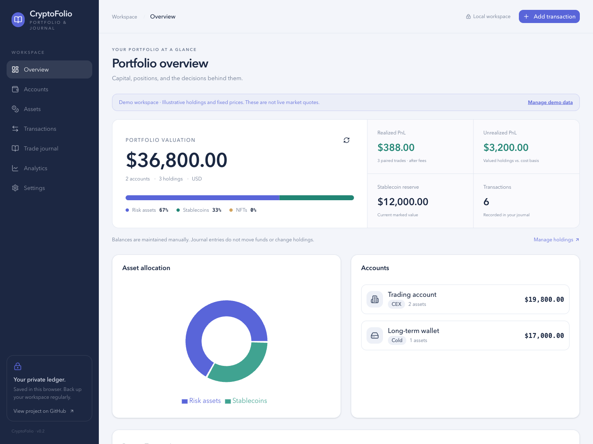

<div align="center">

# CryptoFolio

**把资产、交易与决策，放进同一本账。**

以本地存储为主的加密资产看板与交易复盘工具。无需注册、无需连接钱包。


[快速开始](#快速开始) · [计算口径](#计算口径) · [隐私与边界](#隐私与边界) · [参与开发](CONTRIBUTING.md) · [更新日志](CHANGELOG.md) · [路线图](docs/ROADMAP.md)

</div>



## 能做什么

| 模块     | 用途                                                        |
| -------- | ----------------------------------------------------------- |
| 资产总览 | 汇总账户估值、稳定币储备、资产分布与配对收益                |
| 账户管理 | 分开记录交易所、EVM 钱包、Solana 钱包及冷钱包               |
| 持仓管理 | 手动维护数量、平均成本与覆盖价格，支持 NFT                  |
| 交易账本 | 记录买卖方向、手续费、日期和备注，按账户、类型与状态筛选    |
| 交易复盘 | 将买入与卖出配对，查看扣费收益、ROI（投资回报率）和持有时间 |
| 绩效分析 | 按卖出月份汇总收益，查看胜率与单笔表现                      |
| 备份恢复 | 下载 JSON 备份，校验后预览并确认替换当前工作区              |

新用户可以点击 **Explore with demo data（体验演示数据）**。演示价格为固定示例，不代表实时行情，也不代表任何人的实际持仓。只有空工作区能载入演示；在设置中清除后开始自己的账本。

## 快速开始

需要 Node.js 22.18+ 与 pnpm 10.34.6。

```bash
git clone https://github.com/EricXUzi/v0-crypto-portfolio-journal.git
cd v0-crypto-portfolio-journal
pnpm install --frozen-lockfile --ignore-scripts
pnpm dev
```

打开 [本地工作区](http://localhost:3000)。基础功能无需环境变量或付费 API。

1. 在 Accounts（账户）创建账户。
2. 在 Assets（持仓）录入当前数量与平均成本；无法自动报价的资产可设手动价格。
3. 在 Transactions（交易）记录历史操作和手续费的美元等值。
4. 在 Trade journal（交易复盘）配对同一账户、同一资产、相同数量的买入与卖出。
5. 在 Settings（设置）定期导出备份。

## 计算口径

- **已实现收益**＝配对卖出金额－卖出手续费－买入金额－买入手续费。单独标记为已结算不会自动产生收益。
- **ROI（投资回报率）**＝已实现收益÷含买入手续费的成本。零成本交易显示 0%，不代表实际回报率。
- **APR（简单年化收益率）**＝ROI × 365÷持有天数。持有不足 1 天时不展示；这不是收益预测。
- **未实现收益**＝有估值的持仓市值－其平均成本。缺失报价的持仓不按归零计算；手动设为 0 则明确计入损失。
- 手动价格优先于市场报价；NFT 和未收录币种使用手动估值。自动报价仅按内置常见币种映射请求，不能验证同名代币身份。
- 仅支持一笔完整买入对应一笔完整卖出。部分卖出需要先拆分记录；尚未支持 FIFO（先进先出）和多批次成本分摊。
- **持仓是手动快照，交易是独立账本。**录入、删除与配对交易均不自动增减持仓，避免历史补录重复计账。

## 隐私与边界

账户、地址、持仓和备注保存在当前浏览器的本地存储中，**未加密、无云端同步**。更换浏览器、清除网站数据或设备故障都可能丢失记录，请自行保管备份。

行情请求只向 [CoinGecko](https://www.coingecko.com/en/api) 发送支持的资产标识，不发送钱包地址或交易备注。免费报价可能受网络、跨域或限流影响；页面会提示缺失报价，可以设置手动估值。浏览器仍会向行情服务暴露常规网络信息。

交易复盘采用本地规则生成提示，不会调用 AI 服务或产生模型费用。旧的云端分析接口返回明确的未配置状态。本项目不执行交易、不读取私钥、不提供税务报表或投资建议。

## 常见问题

**为什么录入交易后持仓没有变化？**

交易用于历史复盘，持仓用于记录当前余额。二者独立维护，补录历史交易不会再次增加当前资产。

**为什么资产估值为 0 或显示未报价？**

自动报价只覆盖内置币种，行情也可能被限流。进入 Assets（持仓）的操作菜单设置手动价格；没有报价的持仓会从估值和浮动盈亏中排除，而非记为亏损。

**可以导入旧版本备份吗？**

支持原有账户、持仓、交易和配对四组数组组成的 JSON 备份。恢复时重新校验关联并计算配对收益。日期无效、关联记录丢失、数量不匹配或重复配对的文件会被拒绝，当前数据保持不变。

**可以在多个设备之间同步吗？**

暂不支持自动同步。可导出备份，在另一设备导入；导入前会显示记录数量并要求确认替换。

**能否用作税务或审计凭证？**

当前不具备完整批次成本、法币汇率历史或审计轨迹。它适合个人资产整理与决策复盘，不能直接替代专业税务账本。

## 开发与部署

```bash
pnpm typecheck
pnpm test
pnpm build
pnpm start
```

`pnpm lint` 同时执行 Prettier 格式检查与严格类型检查。[本地验证记录](docs/TESTING.md)列出已检查的页面与场景。测试使用 Node.js 内置测试器，覆盖收益计算、配对规则和备份完整性。GitHub Actions（自动化检查）配置见 [工作流示例](docs/ci-workflow.example.yml)，可放到 `.github/workflows/ci.yml` 启用；当前尚未启用线上自动检查。

部署到支持 Node.js 的 Next.js 托管平台：安装命令使用 `pnpm install --frozen-lockfile --ignore-scripts`，构建命令使用 `pnpm build`，启动命令使用 `pnpm start`。数据按访问域名隔离，更换域名前请导出备份。本仓库不承诺已有在线演示可用。

```text
app/                  页面与兼容接口
components/           账户、持仓、交易、复盘与界面组件
lib/portfolio.ts      独立收益计算
lib/backup.ts         版本化备份与关系校验
lib/store.ts          本地状态与持久化
lib/demo.ts           公开示例数据
lib/hooks/            行情与汇总
tests/               核心逻辑测试
```

项目最初由 v0 生成，现以独立工具维护。使用与贡献规则见 [贡献指南](CONTRIBUTING.md)，漏洞报告见 [安全说明](SECURITY.md)。暂未指定开源许可证；公开可见不等于授予任意再分发许可。
